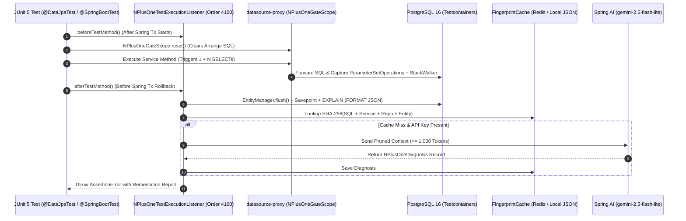

# Spring AI Hibernate N+1 Test Gate

A reusable **Spring Boot 4.1 test starter** (`nplus1-ai-gate-starter`) that catches **Hibernate N+1 query loops** in **JUnit 5** and uses **Spring AI + Google Gemini** to suggest the exact **Java code fix**.

* **Tech Stack**: **Java 21**, **Spring Boot 4.1.x**, **Spring AI 2.0.1**, **Hibernate ORM 7.x**, **PostgreSQL 16** (Testcontainers), **Redis 7** (Testcontainers).


* **Scope**: Runs **only in tests** (`@SpringBootTest`, `@DataJpaTest`) and never in production runtime code.


---

## Why This Project Exists

Standard Java SQL assertion libraries (`datasource-proxy`, `QuickPerf`) only count **SQL queries**. When a test fails, developers still have to guess between **`@EntityGraph`**, **`JOIN FETCH`**, **`@BatchSize`**, or **SQL DTO projections**.

**`nplus1-ai-gate-starter`** solves this inside your **CI/CD pipeline**:

1. **Captures SQL & Parameters**: Wraps the test `DataSource` with **`datasource-proxy`** and records exact **JDBC `set*` method calls** across all threads.


2. **Filters Noise**: Ignores **test setup (`Arrange`) queries**, **`nextval` sequences**, valid **`@BatchSize` fetches**, and **`OFFSET/LIMIT` pagination**.


3. **Links Parent (`1`) and Child (`N`)**: Matches the **Service loop (`N`)** back to the originating **Repository method (`1`)**.


4. **Runs Safe PostgreSQL `EXPLAIN**`: Executes **`EXPLAIN (FORMAT JSON)`** inside a **JDBC `Savepoint**` with **`enable_seqscan = off`** to verify index usage on small test tables.


5. **Caches Diagnoses**: Checks **Redis** or a **local `.nplus1-ai-cache.json` file** by **SHA-256 fingerprint** for **< 10ms** repeat runs.


6. **Generates Structured Fixes**: Calls **`gemini-2.5-flash-lite`** via **Spring AI `ChatClient**` on a cache miss to output a verified **Java fix**.


---

## Architecture Flow



---

## Sample Terminal Failure Report

When an **N+1 query loop** exceeds the threshold (default **`5`**), your **JUnit 5 test** fails with this report:

```text
[N+1 AI GATE FAILURE] Detected 20 repeated SELECT queries (Threshold: 5)
  Parent Query (1) : ContractDeclarationRepository.findConfirmedForParticipantSummary(LocalDate)
  Child Loop   (N) : GridDailySettlementService.buildParticipantSummary(GridDailySettlementService.java:54)
  Offending SQL    : SELECT ... FROM bilateral_contract WHERE id = ?
  PG Explain Plan  : Index Scan on bilateral_contract using bilateral_contract_pkey
  AI Diagnosis     : Lazy @ManyToOne chain (ContractDeclaration -> BilateralContract -> MarketParticipant) fetched inside loop.
  Recommended Fix  : Add @EntityGraph(attributePaths = {"bilateralContract", "bilateralContract.buyer"})
                     to ContractDeclarationRepository.findConfirmedForParticipantSummary(LocalDate).

```

---

## Repository Structure

* **`nplus1-ai-gate-starter/`**: Reusable **Spring Boot test starter** containing `@EnableNPlusOneAiGate`, `NPlusOneTestExecutionListener`, `ExplainPlanRunner`, `FingerprintCache`, and **Spring AI** integration.


* **`grid-settlement-demo/`**: Wholesale **electricity market settlement app** modeling **288 daily 5-minute dispatch intervals**.


* **`docs/RFC-001-architecture-spec.md`**: Full **engineering specification** and edge-case design.


---

## Demo Scenarios (`grid-settlement-demo`)

The demo module tests **three real-world Hibernate patterns** across **288 five-minute energy intervals**:

* **Scenario A (`@ManyToOne` Chain -> `@EntityGraph`)**: Loads 20 `ContractDeclaration` rows and reads `declaration.getBilateralContract().getBuyer().getShortName()` in a loop. The gate recommends **`@EntityGraph`**.


* **Scenario B (`@OneToMany` 288-Row Sum -> SQL DTO Projection)**: Loads 20 declarations and streams `declaration.getIntervals()` (288 child rows each) in Java to sum `declaredMwh`. Instead of loading **5,760 entities** into heap memory with `JOIN FETCH`, the gate recommends a **JPQL `SUM(i.declaredMwh) ... GROUP BY` DTO projection**.


* **Scenario C (Optimized Baseline & `@BatchSize`)**: Runs the refactored methods and a **`@BatchSize(size = 20)`** query to prove the gate passes with **zero false positives** and **zero LLM calls**.


---

## Quick Start

### Prerequisites

* **Java 21+** and **Maven 3.9+**

* **Docker** (required for **Testcontainers PostgreSQL 16 & Redis 7**)


* **Google AI Studio API Key** (optional - falls back to **deterministic SQL + `EXPLAIN` mode** if omitted)


### Run the Tests

```bash
# 1. Clone the repository
git clone https://github.com/builtbyjuls/spring-ai-nplus1-test-gate.git
cd spring-ai-nplus1-test-gate

# 2. (Optional) Export your Gemini API key for live AI diagnosis
export GEMINI_API_KEY="your-api-key-here"

# 3. Run the Testcontainers suite
./mvnw test

```

### Usage in Your Own Project

Add **`@EnableNPlusOneAiGate`** to any **`@SpringBootTest`** or **`@DataJpaTest`** class:

```java
@DataJpaTest
@EnableNPlusOneAiGate(threshold = 5, basePackage = "com.builtbyjuls.grid")
class GridDailySettlementServiceTest {

    @Autowired
    private GridDailySettlementService settlementService;

    @Test
    void shouldDetectNPlusOneOnParticipantSummary() {
        // Arrange: seed test data
        seedDeclarations();
        NPlusOneGateScope.reset(); // Ignore setup SQL

        // Act: triggers N+1 gate analysis before transaction rollback
        settlementService.buildParticipantSummary(LocalDate.of(2026, 10, 15));
    }
}

```

### Pluggable AI Model Providers

The starter programs to the Spring AI `ChatModel` interface. Consumers can plug in any supported Spring AI model starter:

* **Local / Offline (Ollama)**:
  ```xml
  <dependency>
      <groupId>org.springframework.ai</groupId>
      <artifactId>spring-ai-starter-model-ollama</artifactId>
      <scope>test</scope>
  </dependency>
  ```
* **OpenAI**:
  ```xml
  <dependency>
      <groupId>org.springframework.ai</groupId>
      <artifactId>spring-ai-starter-model-openai</artifactId>
      <scope>test</scope>
  </dependency>
  ```
* **Google Gemini**:
  ```xml
  <dependency>
      <groupId>org.springframework.ai</groupId>
      <artifactId>spring-ai-starter-model-google-genai</artifactId>
      <scope>test</scope>
  </dependency>
  ```

If no `ChatModel` bean is present on the application context, the test gate automatically operates in deterministic offline mode without failing.

---

## License

This project is licensed under the MIT License - see the [LICENSE](LICENSE) file for details.

